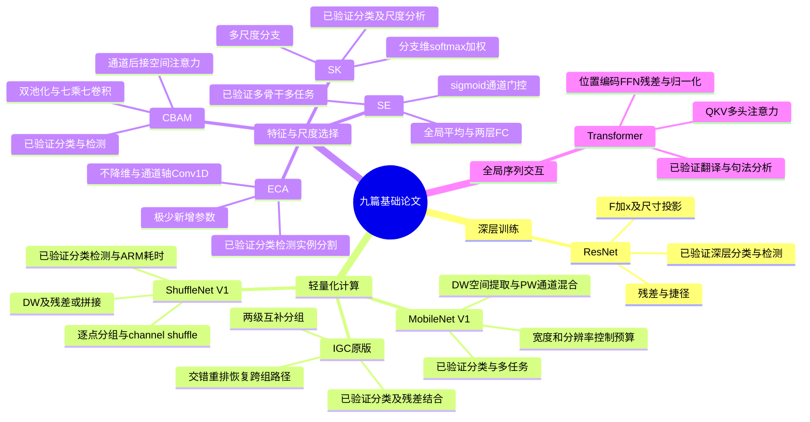

# 九篇基础论文：核心要义、实现方式与验证进展

整理日期：2026-10-28。依据：用户提供的九份 PDF。本文的“进展”指所给论文中已报告的实现与实验，不代表截至今日的社区发展、仓库可用性或用户个人复现进度。本次没有执行训练或验证作者代码。文件夹名“2025基础文献”不意味着这些论文发表于 2025 年。

用户指定的 oral-paper-skill 在本地与插件检索中未找到，故未应用其专属流程；本报告依据原文独立整理。文献中的指令性文字作为材料处理。

## 1. 先抓住整体逻辑

这组论文围绕四个相互关联、但不相同的问题展开：

1. **网络更深，怎样训练得动？** ResNet 用残差连接改善深层网络优化。
2. **计算预算有限，怎样提取特征？** MobileNet 分解卷积，IGC 设计互补分组，ShuffleNet 在分组计算中恢复跨组信息流。
3. **已经提取的特征，怎样按输入调整？** SE 选择通道，ECA 简化通道交互，CBAM 加入空间选择，SK 选择不同感受野分支。
4. **相隔很远的元素，怎样直接交换信息？** Transformer 通过 Q/K/V 注意力聚合序列信息。

共同主题是：**在表达能力、信息交流与计算成本之间重新安排结构。** 但它们不是九个可以直接替换、按同一分数排名的模块。

## 2. 九篇横向比较

| 论文 | 核心问题 | 实现主链 | 改动层级 | 论文已完成的验证 | 主要代价或边界 |
|---|---|---|---|---|---|
| ResNet | 加深后训练误差反而增加 | 残差分支 + shortcut | 骨干与优化结构 | ImageNet、CIFAR、检测/分割相关任务与竞赛 | 加深仍增加计算，不能保证深度无限增加都有效 |
| MobileNet V1 | 标准卷积成本高 | 逐通道 3×3 → 稠密 1×1 | 轻量骨干 | ImageNet、多分辨率/宽度、检测等应用 | 1×1 成为主要计算来源，缩小过度会丢精度 |
| IGC | 稀疏卷积怎样维持通道交流 | 空间分组 → 交错重排 → 逐点分组 | 卷积块 | CIFAR、SVHN、ImageNet、残差结合 | 分组配置与宽度有关，理论省算力不等于设备低延迟 |
| ShuffleNet V1 | 轻量网络的 1×1 仍昂贵 | 逐点分组 → shuffle → DW → 逐点分组 | 轻量骨干 | ImageNet、COCO、ARM 设备耗时 | 分组/搬运成本和设备实现影响实际收益 |
| SE | 通道贡献不应固定 | GAP → FC 降维 → ReLU → FC → sigmoid | 通道重标定模块 | 多骨干分类、场景分类、COCO、竞赛 | 参数随 C²/r 增长，缺少显式位置选择 |
| ECA | 通道注意力怎样更省参数 | GAP → 通道轴 Conv1D → sigmoid | 通道重标定模块 | ImageNet、COCO 检测与实例分割 | 仅局部通道交互；无显式空间注意力 |
| CBAM | 同时判断“哪些特征、哪些位置” | 通道注意力 → 空间注意力 | 串联重标定模块 | ImageNet、COCO、VOC、Grad-CAM | 两级操作增加运行成本，收益随任务而变 |
| SK | 固定感受野难适应尺度变化 | 多尺度分支 → 汇聚 → 分支 softmax → 加权融合 | 动态卷积块 | ImageNet、CIFAR、轻量骨干与尺度分析 | 通常所有分支都计算，不是条件跳过计算 |
| Transformer | 循环串行、长距离交互路径长 | 嵌入/位置 → 多头注意力 → FFN → 编解码 | 序列建模架构 | 英德/英法翻译、句法分析、消融 | 注意力矩阵随长度平方增长，自回归生成仍逐步进行 |

## 3. 逐篇精读

### 3.1 SE — Squeeze-and-Excitation Networks

**一句话：先概括每个通道，再根据整幅图的信息调节该通道的响应。**

- **问题与要义：** 卷积把空间与通道关系混合在一起；SE 显式学习输入相关的通道权重。不同通道可同时重要，因此使用 sigmoid，而不是要求权重总和为 1 的通道 softmax。
- **实现：** 对 `X[B,C,H,W]` 在 H、W 上全局平均池化，得到 `z[B,C]`；用 `C→C/r→C` 两层全连接，中间 ReLU，末尾 sigmoid；权重恢复为 `[B,C,1,1]` 并与原特征相乘。默认 `r=16`。在 SE-ResNet 中作用于残差分支，位置在与 shortcut 相加之前。
- **公式：** `z=GAP(X)`；`s=σ(W₂ ReLU(W₁z))`；`Y=X⊙s`。忽略 bias，单块新增约 `2C²/r` 个参数。
- **论文实现与进展：** 所给文件为较长的扩展版本，已经覆盖 ImageNet、CIFAR-10/100、Places365、COCO 及多种轻量骨干，不止最初的分类实验。ImageNet 表 2：重训 ResNet-50 Top-1 error 从 **24.80% 降至 23.29%**，下降 **1.51 个百分点**；计算约 **3.86→3.87 GFLOPs**，但参数增加约 **2.5M**。ILSVRC 2017 的 **2.251% Top-5 error 是集成与多尺度/多裁剪的竞赛结果**，不能当作单个 SE 模块的结果。
- **训练线索：** ImageNet 对照训练使用同步 SGD、momentum 0.9、batch 1024、初始学习率 0.6、100 epochs，30 epochs 衰减一次。
- **理解边界：** “计算增量小”不等于“参数增量为零”，也不等于端侧延迟增量小；空间位置之间没有独立权重。它对已有特征做重标定，不进行 Transformer 式位置两两聚合。
- **证据：** PDF 第 3–7 页，公式 2–5，图 3，表 2、3、7，§5.4。

### 3.2 ECA — Efficient Channel Attention

**一句话：保留通道维度，用一个很小的一维卷积获得通道权重。**

- **问题与要义：** 论文通过 SE 变体消融认为，避免降维并保留适当局部通道交互，能获得较好的性能/复杂度平衡。这是实验支持的设计选择，不是“降维在所有任务里一定有害”的普遍定理。
- **实现：** `GAP(X)` 后变成 `[B,1,C]`，以通道索引为一维卷积的长度轴；使用 `Conv1D(1,1,k,padding=(k-1)/2,bias=False)`，接 sigmoid，再广播乘回 `[B,C,H,W]`。卷积不是沿图像宽度或高度运行。
- **公式：** `Y=X⊙σ(Conv1D_k(GAP(X)))`。单个模块卷积参数为 `k`。论文以 `k=nearest_odd((log₂C+b)/γ)` 关联 C 和 k，设 `γ=2,b=1`。
- **“自适应”究竟指什么：** k 按通道数选择，在结构确定后固定；不是每张输入图像动态学习一个不同整数 k。复现时应记录具体 k 配置与奇数取整规则，区分论文公式和代码配置。
- **论文实现与进展：** ImageNet 分类、COCO 检测与实例分割均已实验。表 3 报告 ResNet-50 **75.20%→77.48% Top-1 accuracy**，增加 **2.28 个百分点**；摘要报告整网 ECA 模块共 **80 个新增参数**和约 **4.7×10⁻⁴ GFLOPs**。COCO 表 5 中 Faster R-CNN/ResNet-50 的 AP **36.4→38.0**；表 6 中实例分割 AP **34.1→35.6**。
- **训练线索：** ResNet ImageNet 使用 SGD、batch 256、100 epochs；检测使用 MMDetection，COCO train2017→val2017，12 epochs。论文也验证了 MobileNetV2，这与本文件夹里的 MobileNet V1 不同。
- **比较边界：** ECA 表 3 部分准确率引用既有文献，表中速度则在同一平台测量，因此不能把所有准确率都称为作者统一训练的严格对照。其 ResNet-50 的基线也与 SE/CBAM 原文不同。
- **证据：** PDF 第 3–8 页，公式 9、12，表 2、3、5、6。

### 3.3 CBAM — Convolutional Block Attention Module

**一句话：先挑重要通道，再挑这些通道中的重要位置。**

- **实现第一步：** 在空间轴分别做平均池化与最大池化，得到两个 `[B,C,1,1]` 描述；送入**共享** MLP，结果相加后 sigmoid，得到通道权重 `M_c`，乘到输入上。
- **实现第二步：** 在通道轴对已重标定特征分别求平均与最大值，得到两张 `[B,1,H,W]` 图；拼接为 `[B,2,H,W]`，用 `7×7, 2→1` 卷积与 sigmoid 得到空间权重 `M_s`，再次相乘。
- **公式：** `F′=σ(MLP(AvgPool_hw(F))+MLP(MaxPool_hw(F)))⊙F`；`F″=σ(Conv7×7([AvgPool_c(F′),MaxPool_c(F′)]))⊙F′`。
- **关键设计：** 默认 reduction ratio 16；通道→空间顺序。共享 MLP 不表示输入描述相同，而是两路复用参数。空间权重是每位置一个标量并广播至通道，不是每个通道都有一张独立空间图。
- **论文实现与进展：** 已完成池化方式、空间卷积核和模块顺序的消融，跨骨干 ImageNet、COCO/VOC 检测及 Grad-CAM 分析。表 4 中 ResNet-50 Top-1 error **24.56%→22.66%**，比同表 SE 的 **23.14%** 再降低 **0.48 个百分点**；参数 **25.56M→28.09M**，GFLOPs **3.858→3.864**。
- **训练线索：** 原文在 PyTorch 中复现比较网络，ImageNet 使用 224 单裁剪、90 epochs，初始学习率 0.1，每 30 epochs 衰减。
- **理解边界与原文问题：** Grad-CAM 提供定性观察，不足以单独证明因果解释。原文表 1 的参数/GFLOPs 与表 2、4 存在不一致，报告采用表 4；表 6 caption 写“均提升 0.9”，但表格从 27.0→28.1、29.1→30.8，算术上为 +1.1、+1.7，因此不能照搬 caption。
- **证据：** PDF 第 5–10、12–13 页，公式 2、3，表 1–4、6。

### 3.4 SK — Selective Kernel Networks

**一句话：根据输入内容，在不同尺度的卷积分支之间分配权重。**

- **Split：** 两路或多路不同感受野的特征提取。典型两路使用 3×3 普通卷积和 3×3 dilation=2 卷积，后者具有 5×5 的采样范围，但并不等于稠密 5×5 卷积。
- **Fuse：** 分支输出相加 → GAP → FC/BN/ReLU，形成全局描述，紧凑维度 `d=max(C/r,L)`，典型 `r=16,L=32`。
- **Select：** 各分支生成 `[B,C]` logits；对同一通道在**分支维**做 softmax。两路有 `a_c+b_c=1`，输出 `Y_c=a_cU₁c+b_cU₂c`。不要误在通道维归一化。
- **网络落地：** 论文以 ResNeXt 为骨架，替换 bottleneck 中的 3×3 卷积，典型配置 `M=2,G=32,r=16`。
- **论文实现与进展：** 已完成 ImageNet、CIFAR、多分支/膨胀率/组数消融和尺度响应分析；轻量实验选用 ShuffleNetV2。ImageNet 表 2 的 224 单裁剪：ResNeXt-50 error **22.23%**，同骨架 SENet-50 **21.12%**，SKNet-50 **20.79%**；GFLOPs **4.24→4.47**。不能把这里基于 ResNeXt 的 SENet-50 当成 SE 原文的 SE-ResNet-50。
- **训练线索：** ImageNet SGD、batch 256、100 epochs、label smoothing，主结果默认三次运行均值。
- **理解边界：** 这里“动态”指输入相关的分支融合权重；通常先把分支都算出来，再加权，不能据此声称自动减少分支计算。所给论文的重点是分类，不应补写为已经验证了检测/分割收益。
- **证据：** PDF 第 3–7 页，公式 1–6，表 1–7。

### 3.5 IGC — Interleaved Group Convolutions for Deep Neural Networks

**一句话：用两次互补分组卷积，使稀疏计算仍能交换跨组信息。**

- **版本：** 文件名写 IGCV，正文是原始 IGC/IGCNet，不是 IGCV2 或 IGCV3。
- **实现：** 设通道数 `C=L×M`。主分组有 L 组、每组 M 通道，执行空间卷积；将通道从 `[L,M]` 交错重排为 `[M,L]`；次分组有 M 组、每组 L 通道，执行 1×1 卷积；重排回需要的顺序。对 NCHW 可用 reshape→transpose→contiguous→reshape，必须检查张量内存与分组整除条件。
- **关键实现细节：** 原文在整个 IGC 块后放 BN 和 ReLU，主分组与次分组之间**不放非线性激活**；不能简单把 MobileNet 的两次 Conv-BN-ReLU 原样搬过来。
- **参数：** 空间核面积 S、输入输出均为 C 时，主分组 `LM²S`，次分组 `ML²`，合计 `LM(MS+L)`；标准卷积为 `(LM)²S`。这个表达式说明可在预算内增加宽度，但不保证越宽性能越好。
- **论文实现与进展：** 已完成 CIFAR-10/100、SVHN、ImageNet，分析分组数量影响，验证与残差连接结合。表 6：作者 ResNet-18 风格基线 `C=64` 为 **11.151M 参数、1.8G 计算、31.06% Top-1 testing error**；`IGC-L100M2+Ident.` 为 **8.61M、1.3G、26.95%**。这同时改变结构和宽度，不能称为“只加入 shuffle”的增益。
- **训练线索：** MXNet；CIFAR 400 epochs、SVHN 40 epochs，SGD Nesterov；ImageNet 95 epochs、batch 256。
- **与 ShuffleNet 的关系：** 都重视分组后的跨组交流；IGC 的核心是两级互补稀疏连接，ShuffleNet 的核心是面向小预算的逐点分组卷积与通道 shuffle，二者不可等同。
- **证据：** PDF 第 2–7 页，图 1、公式 7–15、§5.2 脚注 4、表 3–6。

### 3.6 MobileNet V1 — Efficient CNNs for Mobile Vision

**一句话：把“每通道的空间提取”和“通道混合”拆成两步，省掉大量乘加。**

- **实现：** `DWConv3×3(groups=C_in)→BN→ReLU→PWConv1×1→BN→ReLU`。首层仍为标准卷积，之后以深度可分离卷积为主体。这里是 V1，没有 V2 的 inverted residual / linear bottleneck。
- **成本：** 输出面积 H×W、输入通道 M、输出 N、核 K 时，标准卷积约 `K²MNHW`；DW+PW 约 `K²MHW+MNHW`，比值 `1/N+1/K²`。K=3 且 N 较大时约节省 8–9 倍乘加，指这一类卷积替换的理论量，不是整机必然加速 9 倍。
- **两种旋钮：** 宽度 α 同时缩放输入/输出通道，计算主项约随 α² 变化；分辨率 ρ 使计算约随 ρ² 变化，但不直接减少卷积权重数。
- **论文实现与进展：** ImageNet 准确率/计算/参数曲线与多应用实验已完成。表 4：全卷积对照 **71.7% / 4866M Mult-Adds / 29.3M 参数**，MobileNet **70.6% / 569M / 4.2M**。表 6 中宽度降到 0.25 后为 **50.6% / 41M / 0.5M**，说明极小预算时精度损失明显。还有细粒度识别、地理定位、检测与人脸相关任务。
- **训练线索：** TensorFlow、RMSprop；对小模型减少正则与过强数据增强，对 DW 权重使用很小或不使用 weight decay。
- **理解边界：** 表 2 的 1×1 卷积约占 **94.86% 乘加、74.59% 参数**，这解释了 ShuffleNet 继续优化逐点卷积的动机。所给 PDF 表 1 的末端 stride 与输入尺寸记录存在不一致，复现应核查实际尺寸流，不能逐字照抄表格。
- **证据：** PDF 第 2–8 页，公式 2、4–7，表 1–9。

### 3.7 ShuffleNet V1 — Efficient CNNs for Mobile Devices

**一句话：把昂贵的逐点卷积也分组，再用通道洗牌弥补组间隔离。**

- **实现：** 1×1 group conv→BN/ReLU→channel shuffle→3×3 depthwise conv→BN→1×1 group conv→BN。stride=1 时与 shortcut 相加；下采样块在 shortcut 用平均池化，最后改为通道拼接。DW 后不额外加 ReLU。
- **Shuffle：** `[B,C,H,W]→[B,g,C/g,H,W]→transpose(1,2)→contiguous→[B,C,H,W]`。shuffle 本身没有可学习权重，但有内存访问代价；它是确定的重排，不是随机打乱。
- **成本：** 等输入输出宽度 c、瓶颈宽度 m 的典型块，约 `HW(2cm/g+9m)`。可把省出的预算用于更多通道。
- **论文实现与进展：** ImageNet、COCO、分组数和 shuffle 消融，以及 Snapdragon 820 单线程延迟均已报告。表 5 在约 40M 预算下：MobileNet 0.25× 为 **49.4% error / 41M**；ShuffleNet 0.5×、g=4 为 **41.6% / 38M**，降低 **7.8 个百分点**。表 8 的另一个 g=3 版本在 224 输入下 **15.2ms**，AlexNet **184.0ms**；注意 g 不同，不能把它与 g=4 最优准确率拼成同一个配置。
- **工程证据：** 作者报告叠加 SE 虽然计算量增量小，手机运行通常慢 **25–40%**，直接支持“FLOPs 与真实延迟要分别测”的结论。
- **理解边界：** 本篇是 V1；不要混入 V2 的 channel split 结构。越多组并非必然越好，性能取决于预算、宽度和设备实现。
- **证据：** PDF 第 2–7 页，图 1、2，表 1–5、8。

### 3.8 ResNet — Deep Residual Learning for Image Recognition

**一句话：让多层网络学习“需要修改多少”，同时用捷径传递输入。**

- **问题与要义：** 原文针对 degradation：普通网络加深后，训练误差也升高，不能只用过拟合解释。论文也没有把这一现象简单归结为梯度消失。
- **实现：** 原版块的结构是 Conv/BN/ReLU→Conv/BN→shortcut 相加→ReLU；瓶颈使用 `1×1降维→3×3→1×1升维`。输入输出尺寸一致时 identity shortcut，不一致时可用 stride 与 1×1 projection 匹配。
- **公式：** 相加前 `y=F(x)+x`，有投影时 `y=F(x)+W_sx`；原始论文在相加后还有 ReLU。不能把后来的 pre-activation 版本当成这里的默认实现。
- **论文实现与进展：** 完成 ImageNet 到 152 层、CIFAR 极深网络与检测相关验证。表 2 的 ImageNet 10-crop：34 层 plain **28.54% error**，34 层 ResNet **25.03%**；表 3 的 ResNet-152 为 **21.43% Top-1、5.71% Top-5 error**。ILSVRC 2015 的 **3.57% Top-5 是集成在测试集的结果**，不能和单模型单裁剪混用。
- **训练线索：** SGD、batch 256、momentum 0.9、weight decay 1e-4，卷积后 BN，不用 dropout。
- **理解边界：** shortcut 提供优化路径，不等于保证任意深度都更好；identity 不新增权重，projection 会。它可与轻量卷积、SE/CBAM/ECA 等组合，不是它们的竞争替代品。
- **证据：** PDF 第 3–7 页，公式 1、2，图 4、5，表 1–5。

### 3.9 Transformer — Attention Is All You Need

**一句话：根据元素间的内容相关性，直接从其他位置聚合信息。**

- **架构：** 编码器 6 层：多头自注意力→FFN；解码器 6 层：因果自注意力→对编码器输出的交叉注意力→FFN。输入嵌入加位置编码，每个子层使用残差、dropout、LayerNorm。原版为 **Post-LN**：`LayerNorm(x+Sublayer(x))`。
- **注意力：** `Q=XW_Q,K=XW_K,V=XW_V`；`Attention=softmax(QKᵀ/√d_k+mask)V`；多头分别投影、并行计算、拼接后输出投影。交叉注意力的 Q 来自解码器，K/V 来自编码器。
- **配置与训练：** base 的 `d_model=512,h=8,d_ff=2048`；正余弦位置编码；Adam β₁=0.9、β₂=0.98、ε=1e-9，4000-step warmup 与 inverse-square-root 学习率，label smoothing 0.1。训练时目标右移，并正确设置因果与 padding mask。
- **论文实现与进展：** 已完成 WMT14 英德与英法翻译、模型规模/头数等消融以及英语成分句法分析。表 2 的 base 英德 **27.3 BLEU**，big **28.4**；big 英法 **41.8 BLEU**。base 使用 8 张 P100 训练约 12 小时，big 约 3.5 天，这是作者当时的硬件条件，不是本次复现耗时或当前设备估计。
- **原文不一致：** 所给版本摘要与表 2 报告英法 **41.8**，§6.1 正文写 **41.0**。此处沿用摘要和表格，保留差异，不自行修正 PDF。
- **理解边界：** self-attention 的位置间交互部分约 `O(n²d)`，显式注意力矩阵空间 `O(n²)`；投影与 FFN 另有成本。训练可并行不等于自回归生成也能一次并行完成。本文没有证明直接用于图像就能获得相同优势；图像任务在结论中仍属未来方向。
- **证据：** PDF 第 3–10 页，图 1、2，公式 1–3，表 1–4。

## 4. 怎样进行可靠的数值比较

以下每行是“各论文内的对照”，**不把不同行组成统一排名**。pp 指百分点，非相对百分比。

| 原文与表格 | 任务、评估口径 | 基线 → 改进 | 变化 | 可得结论 |
|---|---|---|---|---|
| SE 表 2 | ImageNet，单裁剪 Top-1 error | 24.80% → 23.29% | −1.51 pp | 本文训练方案下 SE 有效 |
| ECA 表 3 | ImageNet，Top-1 accuracy | 75.20% → 77.48% | +2.28 pp | 所报基线与 ECA 的精度/开销改善；部分比较取自文献 |
| CBAM 表 4 | ImageNet，单裁剪 Top-1 error | 24.56% → 22.66% | −1.90 pp | 本文统一复现条件下优于其基线 |
| SK 表 2 | ImageNet，224 单裁剪 Top-1 error | 22.23% → 20.79% | −1.44 pp | 对照的是 ResNeXt-50 |
| IGC 表 6 | ImageNet，224 中心裁剪 Top-1 testing error | 31.06% → 26.95% | −4.11 pp | 分组/宽度等共同结构改动有效 |
| MobileNet 表 4 | ImageNet accuracy，全卷积对照 | 71.7% → 70.6% | −1.1 pp | 用小幅精度损失换大幅计算和参数减少 |
| ShuffleNet 表 5 | ImageNet，约 40M 预算 Top-1 error | 49.4% → 41.6% | −7.8 pp | 本文比较的小预算配置更有效 |
| ResNet 表 2 | ImageNet，10-crop Top-1 error | 28.54% → 25.03% | −3.51 pp | 同深度 plain/residual 的优化优势 |
| Transformer 表 2 | WMT14 英德，BLEU | base 27.3 → big 28.4 | +1.1 BLEU | 大模型配置表现更好，计算预算也更高 |

特别注意：

- Error 越低越好，accuracy 越高越好，BLEU/AP 又是不同任务指标。
- ImageNet 并不自动表示相同训练方案：epoch、增强、裁剪、标签平滑、baseline 实现都影响结果。
- 不把竞赛集成与单模型比，不把 10-crop 与 single-crop 比。
- 多篇论文把一次乘加记作一次 FLOP/操作；不同工具可能将乘、加分开计数。比较前先统一统计方式。
- 参数、计算、峰值显存、吞吐和单样本延迟分别记录；不能只凭某一个量判断部署效率。

## 5. 最值得记住的结构差异

| 对比点 | SE / ECA | CBAM | SK | Transformer |
|---|---|---|---|---|
| 权重对象 | 通道 | 通道与空间位置 | 同一通道的不同尺度分支 | query 对各 key 位置 |
| 权重生成 | 汇聚后的通道描述 | 双池化与共享 MLP / 空间卷积 | 汇合后的全局描述 | Q 与 K 的内容相似度 |
| 归一化 | sigmoid | sigmoid | 分支维 softmax | key 维 softmax |
| 输出动作 | 乘回原通道特征 | 依次乘回通道/空间权重 | 对多分支特征求加权和 | 对不同位置的 V 求加权和 |
| 输入相关 | 是 | 是 | 是 | 是 |
| 容易混淆处 | ECA 的 k 不随每张图动态变化 | 空间权重不是位置两两关系 | 动态融合不表示分支免计算 | 与 CNN 通道门控不是同一种运算 |

MobileNet、IGC、ShuffleNet 中的通道连接主要由架构设计固定，训练后卷积参数固定；这不等于它们能像上述注意力机制那样为每个输入显式生成一组权重。ResNet 的贡献则是捷径与残差学习。

## 6. 实现进度：论文事实与后续复现要分开

| 工作 | 原文已实现 | 原文已验证 | 本次完成 | 用户个人进度 |
|---|---|---|---|---|
| 全部九篇 | 方法与网络/模块实现 | 各自实验与消融，范围详见逐篇条目 | 文献提取、方法比较、结果核对、思维导图 | 未提供，无法判定 |

“论文已实现”不等于当前仓库已运行可复现，更不等于你的复现已经完成。论文中提到的代码渠道只说明原文的发布说明，本次没有核验在线可用性：SE 为 hujie-frank/SENet，ECA 为 BangguWu/ECANet，SK 为 implus/SKNet，Transformer 为 tensorflow/tensor2tensor；其余论文的训练框架或公开承诺也不能据此判定今天的维护情况。

以下是**建议的个人复现里程碑，尚未执行**：

1. **理解与单块实现：** 确认公式、输入输出 shape、参数量和梯度。完成标准是结构与维度正确，不是达到论文精度。
2. **同一小数据集闭环：** 先用同一 ResNet 基线分别插入 SE/ECA/CBAM；统一划分、增强和训练预算，保留原始基线。
3. **结构方向的独立对照：** 比较 MobileNet/ShuffleNet/IGC 时匹配计算或参数预算；SK 对照增加同等预算的多分支简单求和，区分“多分支”与“选择机制”的收益。
4. **正式实验与统计：** 在相同框架和硬件记录精度、参数、统一口径计算量、峰值显存、batch=1 延迟及多次随机种子的均值/波动。
5. **目标任务迁移：** 分类结果不能代替检测、分割或特定领域实验；Transformer 先单独完成文本序列任务，若改造为视觉结构，明确其为额外设计。

这套里程碑用于管理复现，不为文献编造“完成百分比”。

## 7. 思维导图

图中验证范围均来自所给论文；这些主题分支表示理解框架，不表示严格的历史先后或直接引用关系。

## 8. 本地来源索引

页码均为 PDF 文件的物理页序；逐篇条目列出定位信息。

1. [SE 原文](<C:/Users/abjecter/Desktop/2025基础文献/1 SE.pdf>)，13 页。
2. [ECA 原文](<C:/Users/abjecter/Desktop/2025基础文献/2 ECA.pdf>)，12 页。
3. [CBAM 原文](<C:/Users/abjecter/Desktop/2025基础文献/3 CBAM.pdf>)，17 页。
4. [SK 原文](<C:/Users/abjecter/Desktop/2025基础文献/4 SK.pdf>)，12 页。
5. [IGC 原文](<C:/Users/abjecter/Desktop/2025基础文献/5 IGCV.pdf>)，11 页。
6. [MobileNet 原文](<C:/Users/abjecter/Desktop/2025基础文献/6 mobilenet.pdf>)，9 页。
7. [ShuffleNet 原文](<C:/Users/abjecter/Desktop/2025基础文献/7 ShuffleNet.pdf>)，9 页。
8. [ResNet 原文](<C:/Users/abjecter/Desktop/2025基础文献/8 Resnet.pdf>)，12 页。
9. [Transformer 原文](<C:/Users/abjecter/Desktop/2025基础文献/9 Transformer.pdf>)，15 页。
